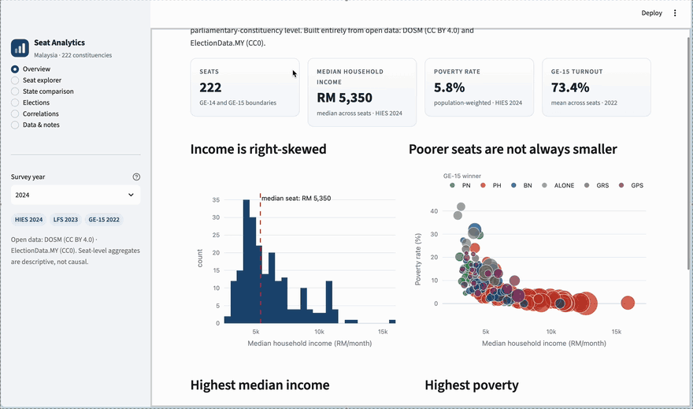

# Projects

## Malaysia Seat Analytics

Streamlit dashboard joining open socio-economic data with GE-14 and GE-15 election results across all 222 Malaysian parliamentary constituencies.

**Stack:** Python, pandas, Plotly, Streamlit. Open data from DOSM and ElectionData.MY.

**Key findings:**

* TODO: finding 1
* TODO: finding 2
* TODO: finding 3

**Code available on request.** Contact: TODO
